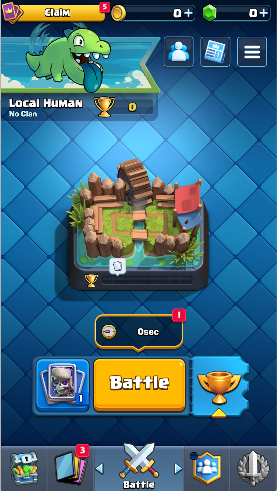
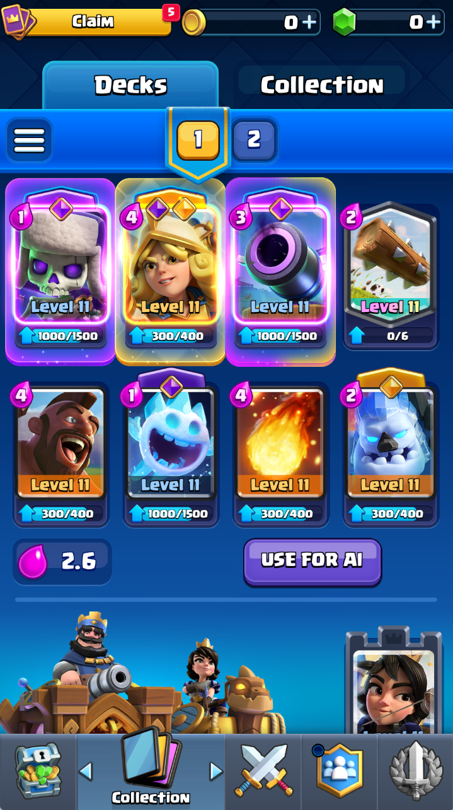
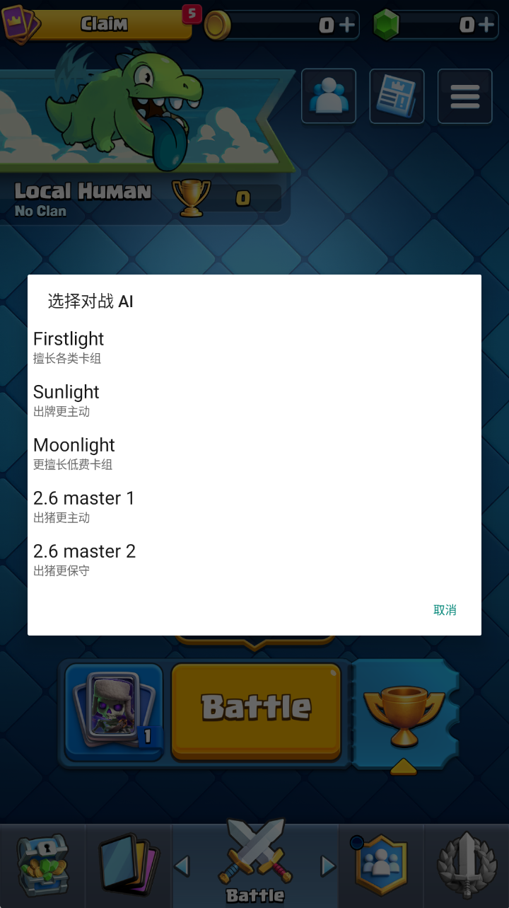
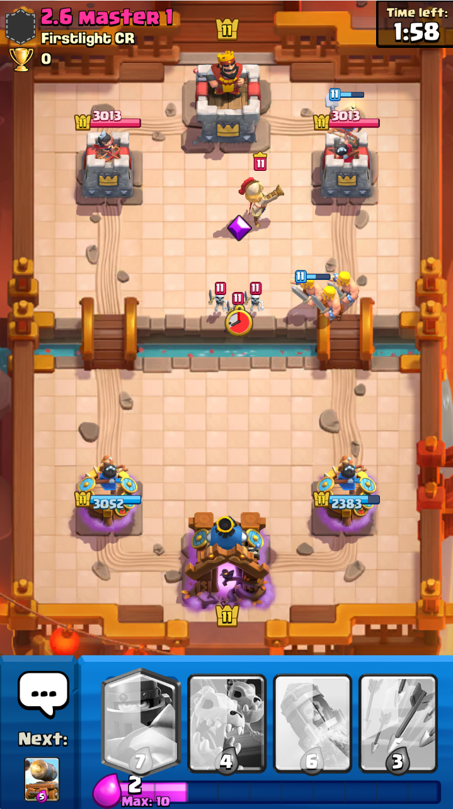

# FL Royale

**在安卓设备上，完全离线挑战皇室战争 AI。** 内置竞技性强的通用 AI，以及达到名人堂水平的 2.6 速猪专家，模型来自 [Firstlight CR](https://github.com/Jaasssoooonnnnn/FirstLight_CR)。

[English](README.md) · [构建指南](docs/build.zh-CN.md)

- **完全离线。** 游戏引擎、资源和五个 AI 模型全部内置于 APK，对战与 AI 推理均在设备本地运行。游玩无需连接服务器、登录账号、电脑或 Root。
- **强劲的通用 AI。** 内置 Firstlight 通用模型具有强竞技性，可使用多种卡组；另有两种不同风格的通用模型可选。

## 实机画面

<table>
  <tr>
    <th width="25%">离线大厅</th>
    <th width="25%">卡组编辑</th>
    <th width="25%">选择 AI</th>
    <th width="25%">对战AI</th>
  </tr>
  <tr>
    <td></td>
    <td></td>
    <td></td>
    <td></td>
  </tr>
</table>

本仓库公开 **1.8-r1** 的源码和构建流程，依赖 Firstlight CR 提供初始离线 APK、模型权重及共用的观察和动作代码。游戏 APK 与下载资源由构建者在本地准备。

## 使用

1. 在 **Collection → Decks** 编辑八卡卡组。
2. 点击卡组页的 **USE FOR AI**，将当前卡组保存给AI；随后可独立更换自己的卡组。
3. 点击 **Battle**，选择对战的AI模型。
4. 使用原生手牌和战场触控出牌。
5. 结算后返回大厅。卡组、昵称和外观选择会在本地保存。

包含 122 张支持卡牌、42 种觉醒、24 种英雄形态及四种塔楼部队，卡牌和塔楼基础等级统一为 11 级。在线商店、部落、排行榜和活动服务不可用。

目标环境为 **Android 7+ / ARM64**。独立包名为 `com.firstlight.offline`，可与 Firstlight CR 的电脑控制版运行器共存。

## 从源码构建

完整步骤见[构建指南](docs/build.zh-CN.md)：

1. 按 Firstlight CR 的教程生成 `cr-ai-offline-cache.apk`。
2. 将受支持版本的游戏更新资源复制到本地。
3. 在 `build.local.json` 填写路径，运行 `tools/build_offline_app.ps1`。

脚本导出五个 ONNX 模型，编译原生桥和安卓运行时，打包资源，并使用本地密钥签名。

## 代码目录

| 目录 | 内容 |
| --- | --- |
| `baseline/native_runner/probe` | 原生对战桥、本地大厅、卡组、收藏和真人操作时序 |
| `on_device` | Java AI 会话与界面、Python 观察与动作适配 |
| `android_runtime_smoke/localapp` | 编译内置安卓运行时的 Gradle 工程 |
| `resource_bootstrap` | 首次启动时安装内置游戏资源 |
| `research/mobile_inference` | 构建使用的 ONNX 导出和张量接口 |
| `research/snapshot_bootstrap_review` | 构建使用的原生本地对战启动代码 |
| `tools` | 构建、资源打包和 APK 修改工具 |

项目源码使用 [Apache-2.0](LICENSE)，Firstlight CR 来源和许可范围见 [NOTICE](NOTICE)。
